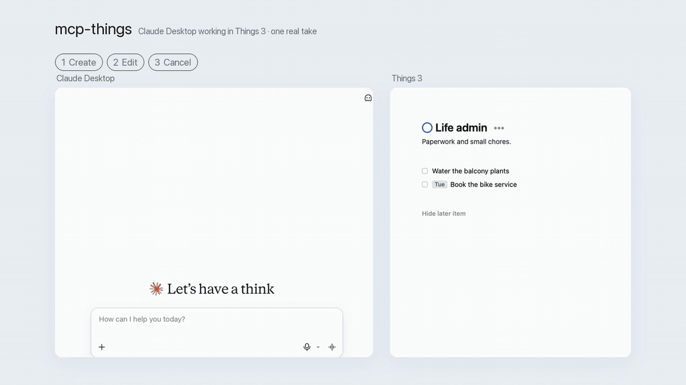
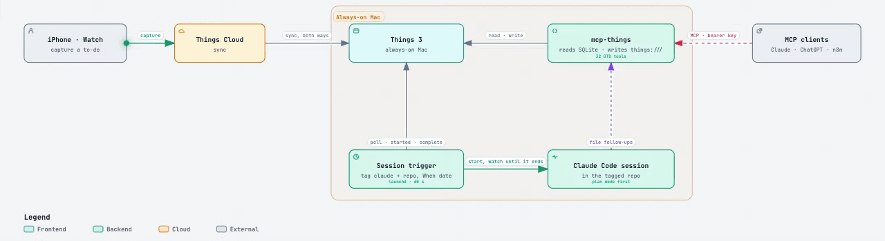

# Things 3 GTD MCP Server

Let Claude, ChatGPT, n8n or any other MCP client work in your [Things 3](https://culturedcode.com/things/) the way GTD intends: capture, clarify, organize, review and engage. 32 tools, built around how an assistant thinks about tasks rather than how the database is shaped.

For Things 3 users on a Mac. This repository is a fork of [excelsier/things-fastmcp](https://github.com/excelsier/things-fastmcp), itself based on [hald/things-mcp](https://github.com/hald/things-mcp); see [History](#history).



*One real take: Claude Desktop creates, edits and cancels a to-do while Things 3 updates beside it. The stopwatch shows real time from each prompt until Things changes; longer waits play at 4×. [MP4 version](docs/media/demo.mp4).*

> **Proven at scale.** In a single June 2026 session this server drove a full top-to-bottom cleanup of a 350+ item Things database: 109 completions, 36 cancellations and bulk-routing reference material to other tools. Across ~150 mutating calls, including 50-item `bulk-complete` / `bulk-cancel` batches, every write landed; the one transient HTTP 502 recovered on an identical retry.

[](https://buymeacoffee.com/caseyberlin)

## Quick start

You need macOS, Things 3 with Things URLs enabled (Things → Settings → General), Python 3.12+ and [uv](https://docs.astral.sh/uv/).

```bash
git clone https://github.com/CaseyRo/mcp-things.git && cd mcp-things
uv sync
uv run python scripts/configure_token.py   # stores the Things URL token, needed for writes
uv run server                              # http://127.0.0.1:8009/mcp, prints your API key
```

Connect Claude Code:

```bash
claude mcp add --transport http --header "Authorization: Bearer tmcp_your-key" things http://127.0.0.1:8009/mcp
```

Claude Desktop, ChatGPT, n8n, running under launchd and reaching the server from another machine: **[docs/setup.md](docs/setup.md)**.

> Review the [Privacy Notice](PRIVACY.md) and [Terms of Use](TERMS_OF_USE.md) before installing.

## Configuration

Settings come from environment variables or `.env` (see `.env.example`).

| Variable | Default | Purpose |
|----------|---------|---------|
| `THINGS_MCP_HOST` | `127.0.0.1` | Bind address |
| `THINGS_MCP_PORT` | `8009` | Listen port |
| `THINGS_MCP_TRANSPORT` | `streamable-http` | Transport (the only supported value) |
| `THINGS_AUTH_TOKEN` | empty | Things URL scheme token; required for write tools |
| `THINGS_MCP_API_KEY` | auto-generated | Bearer token clients must send |
| `THINGS_MCP_PUBLIC_URL` | unset | Public HTTPS URL of the server, used as the auth base URL behind a proxy |
| `THINGS_MCP_DEBUG` | `false` | Verbose console logging |
| `THINGS_MCP_DISABLE_BACKGROUND_OSASCRIPT` | `false` | Bring Things to the foreground during AppleScript calls (debugging) |
| `RETRY_ATTEMPTS` | `3` | Retries for failed operations (1 to 10) |
| `RETRY_DELAY` | `1.0` | Seconds between retries |
| `THINGSDB` | auto-detected | Path to the Things SQLite database |

Every MCP request needs `Authorization: Bearer <THINGS_MCP_API_KEY>`. The key is generated on first start and saved to `.env`; only `/health` and `/healthz` are open.

## Why GTD-native tools

> "Your head's a crappy office." — David Allen

The goal isn't to expose database operations to an AI. It's to give an assistant the tools to help you practice GTD:

- **Capture** thoughts quickly without organizing
- **Clarify** inbox items with GTD decision guidance
- **Organize** tasks by context, energy and time available
- **Reflect** with daily and weekly reviews that surface stalled projects
- **Engage** by finding the right task for your current context

Tools should match how agents think about a problem, not how an API is structured. "Capture this" and "what should I do with 15 minutes at the computer?" are one call each.

## Tools

Full parameters for every tool: **[docs/tools.md](docs/tools.md)**.

### Capture

| Tool | Purpose |
|------|---------|
| `capture-task` | Quick capture to the Inbox without organizing (optional native `checklist`) |

### Clarify

| Tool | Purpose |
|------|---------|
| `process-inbox` | Process the oldest inbox item with GTD decision guidance |
| `convert-to-project` | Turn a task into a multi-step project |

### Organize

| Tool | Purpose |
|------|---------|
| `schedule-task` | Create an organized task with context, dates, project and an optional `repeat` rule |
| `delegate-task` | Mark a task "Waiting For" with person and follow-up |
| `defer-task` | Move to Someday/Maybe or schedule for a future date |
| `modify-task` | Update title, notes, tags, dates, `repeat`; cancel |
| `modify-project` | Update a project; complete or cancel it |
| `plan-project` | Create a project with its first tasks in one step |
| `create-area` | Create an area of responsibility, optionally with projects |
| `modify-area` | Rename an area or update its tags |
| `delete-area` | Remove an area (refuses while it holds loose to-dos) |
| `merge-areas` | Move everything from one area to another, then delete the source |

### Reflect

| Tool | Purpose |
|------|---------|
| `daily-review` | Today's tasks, overdue items and projects, inbox status |
| `weekly-review` | Stalled projects, unassigned projects, waiting-for items, triage activity |
| `triage-insights` | Patterns and trends in how you triage |

### Engage

| Tool | Purpose |
|------|---------|
| `get-tasks` | Context-first task retrieval: view, status, context, energy, time |
| `focus-mode` | The single most important task for your current context |
| `complete-task` | Mark a task done by ID or fuzzy title match |

### Batch

| Tool | Purpose |
|------|---------|
| `bulk-capture` | Capture many tasks to the Inbox in one call |
| `bulk-complete` | Complete many tasks by ID |
| `bulk-cancel` | Cancel many tasks by ID |
| `bulk-modify` | Apply the same changes to many tasks |
| `bulk-triage` | Record triage decisions across many inbox items |

Plus `search-tasks`, `get-projects`, `get-project`, `get-areas`, `get-area`, `get-tags`, `show-in-app` and `get-cache-stats`, the resources `things://inbox/count`, `things://today`, `things://stalled-projects`, `things://triage/stats`, `things://contexts`, `things://config`, and the prompts `weekly-review`, `process-inbox-to-zero` and `plan-project`.

Every tool returns readable text plus a typed JSON envelope (`data`, `summary`, `meta`). The Things URL scheme cannot delete a to-do, so "delete" means cancel; canceled items stay in the Logbook.

## More than a Things remote

A to-do can start work on its own. Tag it for an agent and a repository, and a small trigger opens a coding session in that repo, does the job and ticks the to-do off when the session ends; the session can file its own follow-ups through this server. Because the Things apps are native and fast on the Mac, iPhone, iPad and Watch, they are where commitments actually get written down, which makes Things a good centre for a personal operating system with agents at the edges.



How it works, the guardrails and a runnable example: [docs/beyond-things.md](docs/beyond-things.md).

## Documentation

| Page | What's in it |
|------|--------------|
| [Setup](docs/setup.md) | Install, run, launchd, authentication, every client, remote access |
| [Tools](docs/tools.md) | All 32 tools with parameters, response shape, status filtering, dates and repeats |
| [Architecture](docs/architecture.md) | How reads and writes work, read-back, why it's native, source map |
| [Troubleshooting](docs/troubleshooting.md) | Symptoms, causes and fixes; collecting a log |
| [Development](docs/development.md) | Adding tools, tests, OpenSpec, CI and releases |
| [ChatGPT](docs/clients/chatgpt.md) · [n8n](docs/clients/n8n.md) | Client-specific notes |
| [Migration](docs/MIGRATION.md) | Moving from the old CRUD tools |

## Found a bug? Missing a tool?

Please [open an issue](https://github.com/CaseyRo/mcp-things/issues/new/choose). Questions and ideas are welcome in [Discussions](https://github.com/CaseyRo/mcp-things/discussions). Contributions too: start with [docs/development.md](docs/development.md).

## History

1. **[things-mcp](https://github.com/hald/things-mcp)** by Harald Lindstrøm: the original MCP implementation exposing Things 3 operations.
2. **[things-fastmcp](https://github.com/excelsier/things-fastmcp)** by Yaroslav Krempovych: moved to FastMCP with async tools, caching and reliability features (this repo's fork parent).
3. **GTD-native tools**: redesigned from REST-style CRUD operations to intent-based tools aligned with GTD's five stages.

## Thanks

- **[Cultured Code](https://culturedcode.com)**, for Things 3 and native apps on every Apple device that make this worth building
- **[Harald Lindstrøm](https://github.com/hald)**: original [things-mcp](https://github.com/hald/things-mcp)
- **[Yaroslav Krempovych](https://github.com/excelsier)**: [things-fastmcp](https://github.com/excelsier/things-fastmcp), the upstream of this fork
- **[Jonathan Lowin](https://github.com/jlowin)**: FastMCP
- **[things.py](https://github.com/thingsapi/things.py)**: the Things 3 Python library
- **[David Allen](https://gettingthingsdone.com/)**: GTD

If this server saves you time, you can [buy me a coffee](https://buymeacoffee.com/caseyberlin).

## License

MIT License, see [LICENSE](LICENSE).
